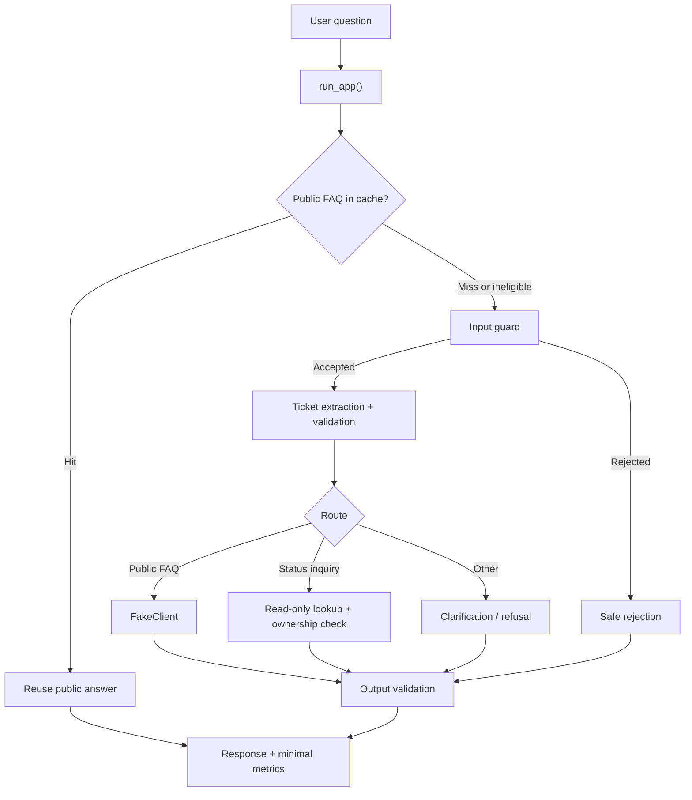

# Murshid Mini

[](https://github.com/SDAIAAcademy)

*A small, testable service assistant built during the LLM Application Engineering course.*

**Student:** **Gamar Aljaliy** ([@gamaraljaliy](https://github.com/gamaraljaliy))  
**Instructor:** **Meaad Al-Marri** ([@almiyead-rgb](https://github.com/almiyead-rgb))  
**Course:** **LLM Application Engineering — SDA-AIE-213**  
**Training:** **SDAIA Academy** · **@SDAIAAcademy** ([GitHub](https://github.com/SDAIAAcademy))

---

## Project Overview

I built Murshid Mini to explore the engineering side of an LLM application, beyond simply generating an answer. It is a fictional service assistant: users can ask how to track an application or check a reference number. The application validates the request, chooses a route, checks record ownership, and returns a controlled response.

The **four-day core project uses a deterministic `FakeClient`**, not a trained language model. This made it possible to test the application logic with predictable results. For the optional homework, I also ran **`google/flan-t5-small` locally on CPU** and evaluated its generated answers.

Everything in the core is written in Python, uses synthetic data, and runs in one cumulative Google Colab notebook. There is no connection to a real government service.

## How It Works



The cache is limited to two exact, public FAQ questions. **Application-status requests are never stored in the shared cache**, and record ownership is checked before returning a status. The optional real-model homework is separate from this mock workflow.

## What I Built

| Day | Focus | Implementation |
| --- | --- | --- |
| **1 — Foundations** | Predictable responses | `FakeClient`, `ask()`, trace IDs, latency and input checks |
| **2 — Structured requests** | Tools and access control | Ticket extraction, strict validation, read-only `check_status()` and ownership checks |
| **3 — Guardrails** | Safer behavior and testing | Input/output guards, 10 golden tests, extra negative tests and prompt-injection regression |
| **4 — Performance and reporting** | Safe caching and measurements | Versioned, 300-second FAQ cache, metrics, regression tests and final JSON exports |

One change I explored independently was the input guard. The original check caught `ignore previous` but missed `Ignore ALL previous instructions`. I added a narrower regex for that variation, then wrote a regression test showing that the request is rejected **before** reaching the status tool. This improves the tested case; it is not comprehensive prompt-injection protection.

## Key Results

These numbers come from the saved notebook outputs and JSON reports, not from a live government system.

| Check | Observed result | Evidence |
| --- | --- | --- |
| Day 1 baseline | Three fixed FAQ responses checked | [Baseline report](results/core/baseline_results.json) |
| Day 2 core | **5/5** reference scenarios; no record changes | [Day 2 report](results/core/day2_results.json) |
| Additional Day 2 validation | **8/8** synthetic cases | [Validation report](results/core/day2_validation_results.json) |
| Day 3 + final regression | **10/10** golden cases passed after caching | [Final report](results/core/final_report.json) |
| Day 3 guard improvements | **5/5** extra cases; prompt-injection regression passed | [Core notebook](notebooks/murshid.ipynb) |
| Day 4 cache experiment | **3 → 1** mock calls; **66.7%** cache hits | [Cache results](results/core/day4_results.json) |
| Homework: tool dispatch | **7/7** tests; records unchanged | [Tool report](results/homework/day2_tools_result.json) |
| Homework: caught errors | **3/3** expected rejections; corrected input accepted | [Error report](results/homework/day3_errors_result.json) |
| Homework: real-model evaluation | **3/3** keyword hits; all three answers supported by context in manual review | [Observed model results](results/homework/evaluation_result.json) |

The real-model homework ran `google/flan-t5-small` on CPU with **zero external inference API calls**. Its keyword check only tests for the words “reference” and “number”; the three-question manual review is not a general accuracy benchmark. The core cache experiment measures mock-client calls, not billed API savings.

## Repository Structure

```text
Murshid_Gamar_Sadaia/
├── README.md
├── notebooks/
│   └── murshid.ipynb
├── homework/
│   ├── day1_real_model.ipynb
│   ├── day2_tools.ipynb
│   ├── day3_errors.ipynb
│   └── day4_evaluation.ipynb
├── results/
│   ├── core/
│   │   ├── baseline_results.json
│   │   ├── day2_results.json
│   │   ├── day2_validation_results.json
│   │   ├── day3_results.json
│   │   ├── day4_results.json
│   │   ├── final_report.json
│   │   ├── metrics.json
│   │   └── synthetic_data.json
│   └── homework/
│       ├── day1_live_demo_result.json
│       ├── day2_tools_result.json
│       ├── day3_errors_result.json
│       └── evaluation_result.json
└── docs/
    ├── project-notes.md
    └── synthetic-data.md
```

The single [core notebook](notebooks/murshid.ipynb) contains Days 1–4. Each optional homework has its own notebook and runtime, so model dependencies do not affect the core.

## Run the Project

**Core (no installation needed)**

1. Open [`notebooks/murshid.ipynb`](notebooks/murshid.ipynb) in Google Colab.
2. Select **Python 3.9+ / CPU**. The core uses only Python's standard library.
3. Run all cells in order. The final checks should report **10/10** golden tests and **66.7%** cache hits.
4. Exported results are saved under `murshid_outputs/` in Colab and tracked in [`results/core/`](results/core).

**Optional homework (separate notebooks)**

| Notebook | What it demonstrates | Setup |
| --- | --- | --- |
| [Day 1 — Real model](homework/day1_real_model.ipynb) | A generated answer using FLAN-T5 | CPU; model download |
| [Day 2 — Controlled tools](homework/day2_tools.ipynb) | Validation, tool allowlist and authorization | Python standard library |
| [Day 3 — Error handling](homework/day3_errors.ipynb) | Deliberate `ValueError` cases and corrections | Python standard library |
| [Day 4 — Model evaluation](homework/day4_evaluation.ipynb) | Three paraphrases, token counts, inference time and manual review | CPU; model download |

The real-model notebooks used `transformers==4.49.0` and `sentencepiece==0.2.1` on Colab. They do not need a paid API key.

## Data, Limits & Next Steps

All service answers, application references and user identities are **fictional**. For example, `REF-1001` belongs to demo user 1 and returns `under_review`; `REF-1002` belongs to another demo user and is not disclosed to demo user 1. The [dataset card](docs/synthetic-data.md) lists the records and the ticket fields.

This is an educational prototype, not an authenticated or deployed service. The input guards cover selected patterns, the mock client does not perform open-ended language understanding, and passing a small test suite does not establish production security or model quality. The illustrative **$0.0036/request** in the final report is not an actual bill.

A useful next step would be testing more Arabic paraphrases and unsupported questions with a larger, manually reviewed dataset, before considering a real model-backed service.

For implementation decisions, tests and limitations, see [Project Notes](docs/project-notes.md). For the original course labs and learning material, see the [instructor repository](https://github.com/almiyead-rgb/murshid-llm-application-engineering-sda-aie-213).

---

Built as part of **LLM Application Engineering (SDA-AIE-213)**, delivered in the **SDAIA Academy** training context. The repository documents my coursework; it does not imply Academy endorsement of the implementation.
